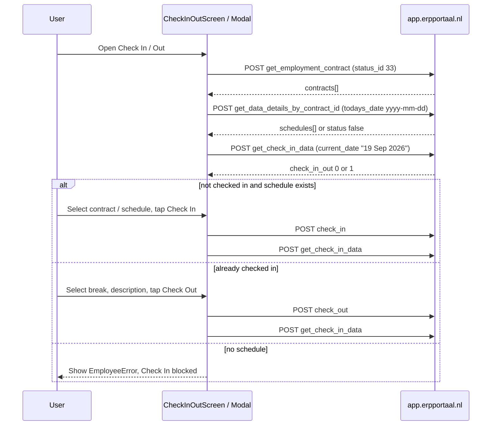

# Check-In / Check-Out Flow

Step-by-step screen and API map for employee CICO, project CICO, and timeline CICO.

**Base URL:** `https://app.erpportaal.nl/api/`  
**Service file:** `newSRC/services/checkInOutService.ts`  
**HTTP client:** `newSRC/utils/client.tsx` (axios)

Every `apiClient` request automatically adds:

```json
{
  "relaties_id": "<from USERDATA>",
  "user_id": "<from USERDATA>",
  "role": "<from USERDATA>",
  "token": "<user.verify_token>"
}
```

Logs:

- Request: `🚀 API => <url> | POST | REQUEST => ...` (`newSRC/utils/client.tsx`)
- Response: `✅ API => <url> | RESPONSE => ...` (even when `status: false`)

---

## Date formats

The app uses **two different date strings**. Mixing them up is a common source of empty schedules.

| Name | Example | Where used |
| --- | --- | --- |
| `apiDate` | `2026-09-19` | `get_data_details_by_contract_id` (`todays_date`) |
| `displayDate` | `19 Sep 2026` | `check_in`, `check_out`, `get_check_in_data` (`current_date`) |

Built in `getTodayFormats()` in `checkInOutService.ts`.

---

## How the user reaches CICO

```
HomeScreen  ── tile link_to="checkinout" ──────────► EmployeeCheckInOutModal
            ── tile link_to="Check_In/Out_for_Project" ► ProjectCheckInOutModal

Route /(app)/check-in-out          ► CheckInOutScreen          (full page)
Route /(app)/check-in-out/project  ► ProjectCheckInOutScreen   (full page)

TimelineScreen ── employee FAB/modal ► TimelineTravelCheckInOutModal  (different APIs)
               ── project tile       ► ProjectCheckInOutModal
```

Home tiles come from `POST get_home_items`. CICO tiles do **not** navigate to the full screen; they open a modal after checking current status.

---

## 1. Home screen

**File:** `newSRC/screens/Home/HomeScreen.tsx`  
**Route:** `/(app)/(tabs)` (home tab)

### On load / pull-to-refresh

| Step | API | Constant | Body (extra) |
| --- | --- | --- | --- |
| 1 | `POST get_home_items` | `apiConstants.home` | `{ role }` |

### On focus

| Step | API | Constant | Body (extra) |
| --- | --- | --- | --- |
| 2 | `POST get_check_in_data` | `apiConstants.getcheckout` | `{ current_date: displayDate }` |
| 3 | `POST get_data_cico_project_id` | `apiConstants.getdatacicoprojectid` | `{ todays_date: displayDate }` |

Used only to remember if the user is already checked in.

### Tap **Employee Check In/Out** tile (`link_to === "checkinout"`)

1. Call `get_check_in_data`.
2. If `data.check_in_out` is `1` → open modal in **check-out** mode.
3. Else → open modal in **check-in** mode.

### Tap **Project Check In/Out** tile (`link_to === "Check_In/Out_for_Project"`)

1. Call `get_data_cico_project_id`.
2. If already checked in → project modal **check-out**.
3. Else → project modal **check-in**.

---

## 2. Employee Check In/Out — full screen

**Screen:** `newSRC/screens/CheckInOut/CheckInOutScreen.tsx`  
**Route:** `newSRC/app/(app)/check-in-out/index.tsx` → `/(app)/check-in-out`

This screen has two UI states on the same page: **Check In** (not yet in) and **Check Out** (already in).

### 2.1 Screen open (`loadInitial`)

```
1. POST get_employment_contract
2. POST get_data_details_by_contract_id   (first active contract)
3. POST get_check_in_data
```

#### API 1 — active contracts

- Function: `fetchActiveEmployeeContracts()`
- Endpoint: `POST get_employment_contract`
- Constant: `apiConstants.employee`
- Body:

```json
{ "status_id": 33 }
```

- App then keeps only contracts whose `from`–`end` range includes today.
- First contract is auto-selected.

#### API 2 — schedule for selected contract

- Function: `fetchContractSchedule(contractId, apiDate)`
- Endpoint: `POST get_data_details_by_contract_id`
- Constant: `apiConstants.getcontractschedule`
- Body:

```json
{
  "contract_id": "<selected contract id>",
  "contract_type": "employment_contract",
  "todays_date": "2026-09-19"
}
```

**Success with schedule**

```json
{
  "status": true,
  "data": {
    "success": true,
    "data": [
      {
        "start_time": "09:00",
        "end_time": "17:00",
        "break_time": "00:30",
        "day": "Saturday",
        "class_id": "",
        "schedule_status": { "Scheduled": true }
      }
    ]
  }
}
```

Schedule badge text comes from `schedule_status`: `Scheduled` / `Not Scheduled` / `Switch Date` / `Absence` / `Leave`.

**No schedule (the log you saw)**

```json
{
  "data": [],
  "message": "Employer Calendar Schedules not found for date <b>19 Sep 2026</b>",
  "status": false,
  "status_code": 429
}
```

App behaviour:

- Axios still logs `✅` because HTTP succeeded.
- `fetchContractSchedule` treats `status: false` as empty.
- Returns `{ schedules: [], scheduleLabel: "" }`.
- Screen shows translation key `EmployeeError` (no schedule for today).
- Check-in button still shows, but submit alerts *Please select contract and schedule*.

#### API 3 — already checked in?

- Function: `fetchCheckInOutState(displayDate)`
- Endpoint: `POST get_check_in_data`
- Constant: `apiConstants.getcheckout`
- Body:

```json
{ "current_date": "19 Sep 2026" }
```

If `data.check_in_out === 1` the screen **skips the contract/schedule UI** and shows the check-out form. Also stores `CHECK_IN_ID` and `CHECKINOUT` locally.

### 2.2 User changes contract

Bottom sheet → `handleContractSelect` → only API 2 again (`get_data_details_by_contract_id`) for the new `contract_id`.

### 2.3 Check In tap (`handleSubmit` when `checkedIn === false`)

Requires selected contract **and** selected schedule card.

| Step | API | Body (extra) |
| --- | --- | --- |
| 1 | `POST check_in` | see below |
| 2 | `POST get_check_in_data` | `{ current_date: displayDate }` (refresh UI) |

`performCheckIn()` body:

```json
{
  "contract_id": "<id>",
  "original_end_time": "<schedule.end_time>",
  "original_break_time": "<schedule.break_time>",
  "check_in_out": "1",
  "original_day": "<schedule.day>",
  "start_time": "<schedule.start_time>",
  "original_start_time": "<HH:mm now>",
  "class_id": "<schedule.class_id>",
  "schedule_status": "Scheduled",
  "current_date": "19 Sep 2026"
}
```

On success: toast `EmployeeCheckIn`, then reload state so the screen switches to check-out.

### 2.4 Check Out tap (`handleSubmit` when `checkedIn === true`)

UI: relation name, contract name, date, time, break chips (`break_data`), description.

| Step | API | Body (extra) |
| --- | --- | --- |
| 1 | `POST check_out` | see below |
| 2 | `POST get_check_in_data` | refresh |

`performCheckOut()` body:

```json
{
  "start_time_check_out": "<checkData.start_time>",
  "end_time_check_out": "<checkData.end_time>",
  "description": "<user text>",
  "check_in_out": "0",
  "original_start_time_out": "<checkData.original_start_time>",
  "original_end_time_out": "<checkData.original_end_time>",
  "original_break_time_out": "<selected break HH:mm>",
  "original_day": "<checkData.day>",
  "check_in_id": "<CHECK_IN_ID or checkData.id>",
  "current_time_check_out": "<HH:mm now>",
  "current_date": "19 Sep 2026"
}
```

---

## 3. Employee Check In/Out — Home modal

**Component:** `newSRC/Components/EmployeeCheckInOutModal.tsx`  
**Opened from:** Home (and can be reused elsewhere)

Same APIs as the full screen, split by modal mode.

### Check-in mode (`loadCheckInData`)

```
POST get_employment_contract
POST get_data_details_by_contract_id
```

Does **not** call `get_check_in_data` on open (Home already did that to pick the mode).

Submit:

```
POST check_in
```

Special case: if the backend says the relation is already checked in (`isAlreadyCheckedInError`), the modal **switches itself to check-out mode** and then calls `get_check_in_data`.

### Check-out mode (`loadCheckOutData`)

```
POST get_check_in_data
```

Submit:

```
POST check_out
```

Then `onComplete()` → Home refreshes both employee and project status.

### Contract change in modal

Same as full screen: `POST get_data_details_by_contract_id`. Empty result shows `EmployeeError` plus today's `displayDate`.

---

## 4. Project Check In/Out — full screen

**Screen:** `newSRC/screens/CheckInOut/ProjectCheckInOutScreen.tsx`  
**Route:** `/(app)/check-in-out/project`

### Screen open

| Step | API | Constant | Body (extra) |
| --- | --- | --- | --- |
| 1 | `POST get_projects` | `apiConstants.getprojects` | `{ relaties_id, role, user_id }` |
| 2 | `POST get_data_cico_project_id` | `apiConstants.getdatacicoprojectid` | `{ todays_date: displayDate }` |

### Check In

Requires a selected project.

```
POST store_project_check_in
```

Body:

```json
{
  "todays_date": "19 Sep 2026",
  "project_id": "<id>",
  "currect_time": "<HH:mm>",
  "currect_address": "<typed location>",
  "working_address": "<project.gmaps_working_address>",
  "check_in_out": "1",
  "hour_rate": "<project.hour_rate>",
  "cost": "<project.travel_cost>"
}
```

Then refresh with `get_data_cico_project_id`.

### Check Out

```
POST store_project_checkout
```

Body:

```json
{
  "todays_date": "19 Sep 2026",
  "project_id": "<checkData.id>",
  "check_in_project_time": "<checkData.original_start_time>",
  "currect_time": "<HH:mm>",
  "description": "<user text>",
  "check_in_out": "0",
  "original_project_break_time_check_in_out": "<selected break>"
}
```

---

## 5. Project Check In/Out — Home / Timeline modal

**Component:** `newSRC/Components/ProjectCheckInOutModal.tsx`

| Mode | On open | On submit |
| --- | --- | --- |
| check-in | `POST get_projects` | `POST store_project_check_in` |
| check-out | `POST get_data_cico_project_id` | `POST store_project_checkout` |

Check-in in the modal **requires** a non-empty current address (full screen does not block on empty address).

---

## 6. Timeline Check In/Out (travel CICO)

**Screen:** `newSRC/screens/Timeline/TimelineScreen.tsx`  
**Modal:** `newSRC/Components/TimelineTravelCheckInOutModal.tsx`  
**Service:** `newSRC/services/timelineCicoService.ts`

This is a **different** backend family (`cico/...`). It does not use `get_data_details_by_contract_id`.

### Timeline open / focus

| Step | API | Constant |
| --- | --- | --- |
| 1 | timeline list | `fetchTimelineCheckInOut()` → `apiConstants.timeline` / related |
| 2 | `POST cico/get-checkin-checkout-data-by-relaties-id` | `apiConstants.gettimelinedata` |
| 3 | `POST get_data_cico_project_id` | project status for the project modal |

`gettimelinedata` extra body: `{ relaties_id, role, user_id, date: apiDate }`.

### Timeline employee travel submit

| Action | API | Constant |
| --- | --- | --- |
| Check in | `POST cico/store/check_in` | `apiConstants.checkintimeline` |
| Check out | `POST cico/store/check_out` | `apiConstants.checkouttimeline` |

---

## API cheat sheet

| Constant | Endpoint | Used on |
| --- | --- | --- |
| `home` | `get_home_items` | Home |
| `employee` | `get_employment_contract` | Employee screen + modal |
| `getcontractschedule` | `get_data_details_by_contract_id` | Employee screen + modal |
| `getcheckout` | `get_check_in_data` | Home, employee screen, employee modal checkout |
| `checkin` | `check_in` | Employee screen + modal |
| `checkout` | `check_out` | Employee screen + modal |
| `getprojects` | `get_projects` | Project screen + modal |
| `getdatacicoprojectid` | `get_data_cico_project_id` | Home, project screen, project modal, Timeline |
| `storeprojectcheckin` | `store_project_check_in` | Project screen + modal |
| `storeprojectcheckout` | `store_project_checkout` | Project screen + modal |
| `gettimelinedata` | `cico/get-checkin-checkout-data-by-relaties-id` | Timeline |
| `checkintimeline` | `cico/store/check_in` | Timeline travel modal |
| `checkouttimeline` | `cico/store/check_out` | Timeline travel modal |

All constants: `newSRC/utils/apiConstants.ts`.

---

## Employee happy path (sequence)



---

## Local storage keys

| Key | Set when |
| --- | --- |
| `CHECK_IN_ID` | Employee `get_check_in_data` or `check_in` returns an id |
| `CHECKINOUT` | Employee check-in / check-out / status fetch |
| `CHECK_IN_ID_PROJECT` | Project status fetch |
| `CHECKINOUT_PROJECT` | Project status fetch |
